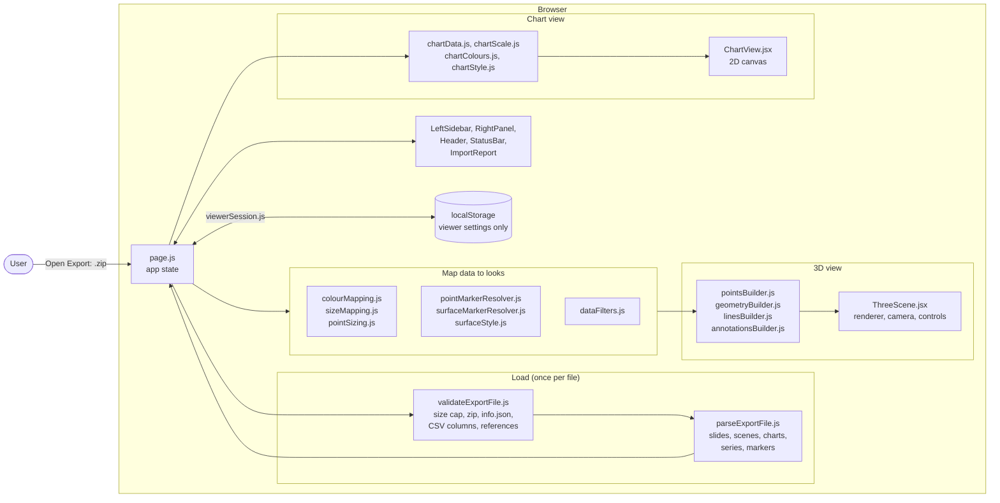
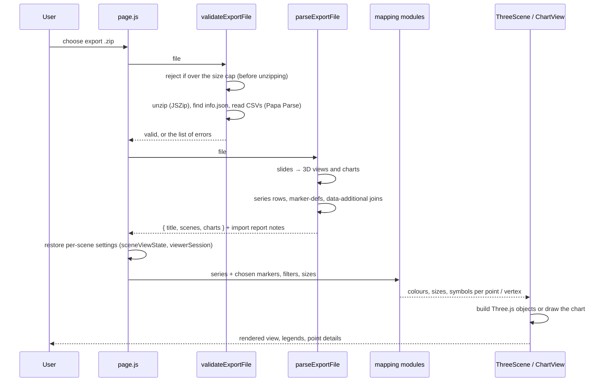

# Architecture

This document explains how the Mining 3D Data Viewer is put together, for a developer who will
maintain or extend it. For setup, see [mxrap-viewer/README.md](../mxrap-viewer/README.md); for
what each feature does, see the [user guide](USER_GUIDE.md).

## Overview

The viewer is a single-page web application (Next.js 16, React 19, Three.js) that runs entirely
in the browser. There is no backend and no database: the user picks an mXrap export `.zip`, the
browser reads, checks and draws it, and nothing is uploaded. The built site can be served by any
Node.js host or, with a static export, by any static web server.

## Data flow: from an mXrap export to the screen

1. **Validate.** `validateExportFile.js` checks the file before anything is drawn: the compressed
   size against the cap (100 MB by default, set in `viewer.config.json`) before unzipping, that
   it is a zip with an `info.json` (`archiveRoot.js` also finds it inside one top-level folder),
   and that every display's CSV files, columns and references exist. It returns all problems at
   once.
2. **Parse.** `parseExportFile.js` reads `info.json` slides into 3D scenes and charts. For each
   series it reads the data CSV (and any `data-additional` CSVs joined by `ID`), its marker menu
   from `marker-defs`, and surfaces, lines and text. Rows that fail checks are skipped and listed
   in the import report.
3. **Hold state.** `page.js` keeps the parsed export, the current scene or chart, and each scene's
   own settings (`sceneViewState.js`). `viewerSession.js` saves those settings in the browser's
   `localStorage`, keyed by file name and size, so reopening the same export can pick up where the
   user left off. Only settings are stored, never the export's data.
4. **Map.** Pure modules turn data values into what is drawn: `colourMapping.js` (ramps,
   colour spaces, null colours), `sizeMapping.js` and `pointSizing.js` (marker sizes and mXrap's
   distance attenuation), the marker resolvers, `surfaceStyle.js` and `dataFilters.js`.
5. **Draw.** `ThreeScene.jsx` owns the WebGL renderer, the perspective and orthographic cameras,
   `cameraControls.js` (OrbitControls), the plan-view grid and the XYZ indicator, and adds the
   objects made by the builders. Charts are drawn on a 2D canvas by `ChartView.jsx`.

## Main modules

All source is in `mxrap-viewer/app`. Logic modules (`.js`) do not depend on React, so they are
unit-tested directly (`components/__tests__`); React components (`.jsx`) are thin.

| Area | Modules | Responsibility |
| --- | --- | --- |
| App shell | `page.js`, `layout.js` | Loading a file, app state, which view is open, per-scene settings |
| Validation | `validateExportFile.js`, `archiveRoot.js`, `dataValidation.js`, `markerValidation.js`, `surfaceValidation.js` | Size cap, archive structure, required columns and references |
| Parsing | `parseExportFile.js`, `parseChartConfig.js`, `lineSeriesData.js`, `pointSeriesData.js`, `jsonLenient.js`, `customerDate.js`, `displayTitles.js` | Turning the export into scenes, charts and series |
| Markers and colours | `colourMapping.js`, `sizeMapping.js`, `pointSizing.js`, `pointMarkerResolver.js`, `surfaceMarkerResolver.js`, `surfaceStyle.js`, `markerSelection.js`, `markerLookup.js`, `markerFallback.js`, `markerSymbols.js`, `colourLegend.js` | mXrap marker model: colour ramps, sizes, symbols, legends |
| Filters | `dataFilters.js` | Number, date and category filters per point series |
| 3D rendering | `ThreeScene.jsx`, `pointsBuilder.js`, `geometryBuilder.js`, `linesBuilder.js`, `annotationsBuilder.js`, `annotationStyleOptions.js` | Point clouds (custom shader), surface meshes, lines, text labels |
| Camera and navigation | `cameraControls.js`, `cameraState.js`, `sceneViewState.js`, `planGrid.js`, `orientationGizmo.js` | Rotate/zoom/pan, Fit/Reset/Top/Front/Side, projection switch, grid, XYZ indicator |
| Charts | `ChartView.jsx`, `chartData.js`, `chartScale.js`, `chartColours.js`, `chartStyle.js`, `chartText.js`, `chartPointDetails.js` | Axes and scales, series data, colours, point picking |
| Panels | `LeftSidebar.jsx`, `FilterPanel.jsx`, `FilterControls.jsx`, `MarkerSelectorPanel.jsx`, `RightPanel.jsx`, `PointInspectionPanel.jsx`, `pointDetails.js`, `Header.jsx`, `StatusBar.jsx`, `ImportReport.jsx`, `PlanGridLabels.jsx`, `AxisIndicator.jsx` | User interface around the view |
| Session | `viewerSession.js` | Remembering settings per file in `localStorage` |
| Demo data | `mockScenes.js` | Data shown before a file is opened |

## Key design decisions

| Decision | Why | Source |
| --- | --- | --- |
| Everything runs in the browser; no backend, no database | The client required that mining data is not uploaded to a server, and indicated exports can reach about 100 GB, which makes uploading impractical. Only static hosting is needed | [Business Requirements Analysis](Business_Requirements_Analysis_Group12_.pdf), 4.3.2 |
| Three.js rather than VTK.js | Recommended by the facilitator, used in a comparable mining visualisation project, and JavaScript-native with extensive documentation; the client had no strong preference. VTK.js stays an option | Business Requirements Analysis 4.3.3; [technology analysis](../tech-docs/) |
| Next.js and React | Team familiarity, reducing implementation risk so effort goes into file processing and 3D | Business Requirements Analysis 4.3.1 |
| Logic in plain modules, separate from React components | So parsing, validation, colour and size mapping, filters and chart scales can be unit-tested without a browser | `components/__tests__` |
| Validate before parsing; cap the compressed size before unzipping | A corrupt or oversized file is rejected with clear errors instead of exhausting browser memory part-way | Issue #101, PR #131 |
| Points drawn as one GPU point cloud with a custom shader | Thousands of events stay fast, and the shader follows the distance-attenuation formula the client supplied, so point sizes behave as in mXrap | Client email, 4 August 2026; `pointsBuilder.js`, `pointSizing.js` |
| Lines wider than 1 px drawn as screen-space wide lines; hairlines as native lines | Wide-line triangles made a dense wireframe sphere look solid; hairlines keep events inside it visible, as in the client's mXrap screenshots | `linesBuilder.js` |
| Each scene keeps its own settings | The client asked for scenes to be independent and to be found as they were left | Client email, 22 September 2026; PR #137 |
| Only HSV and RGB colour spaces in this version | The client's priority was "none"/"linear" ramps and at least HSV, RGB and CIELCHuv; CIE spaces were left for later, and a marker that needs one falls back to magenta | Client email, 4 August 2026; `colourMapping.js` |

## Testing

`npm test` runs the Vitest suite (768 tests in 43 files on 22 October 2026). Twelve test files
load real exports from `test-data`. `npm run lint` and `npm run build` complete the checks, and
the GitHub Actions workflow runs all three on every pull request. React components and WebGL
output are checked by hand in the browser. See [mxrap-viewer/README.md](../mxrap-viewer/README.md#running-the-checks).
