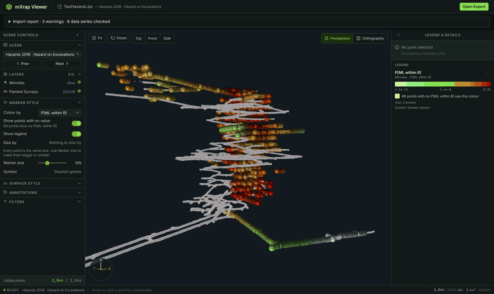
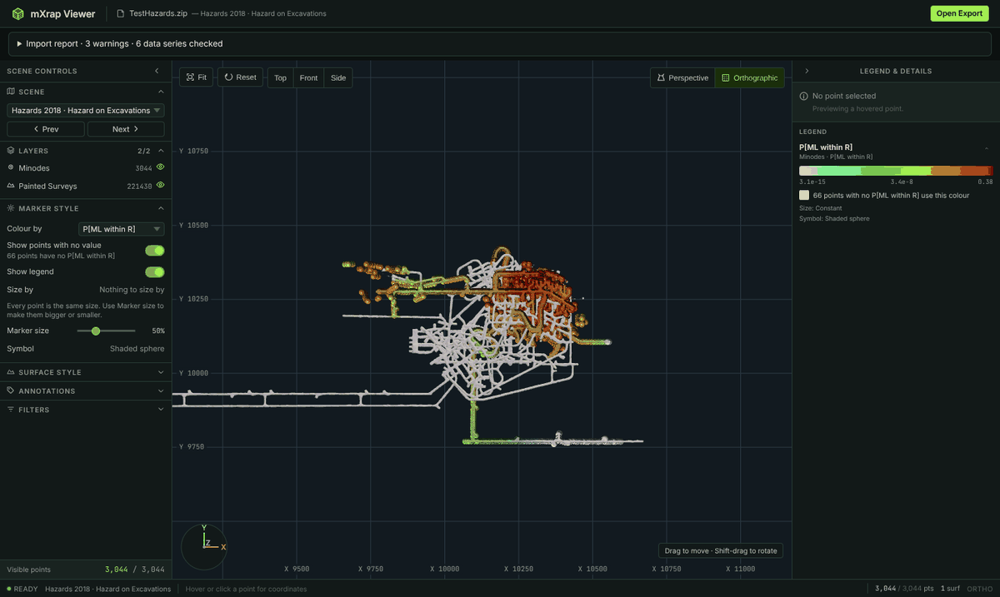
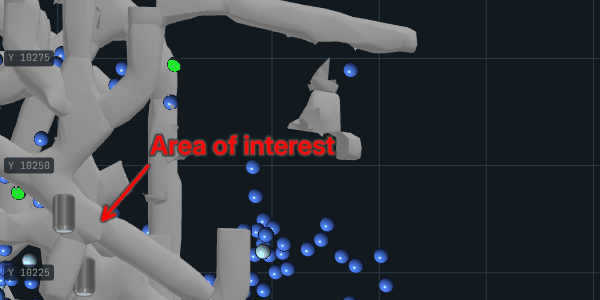
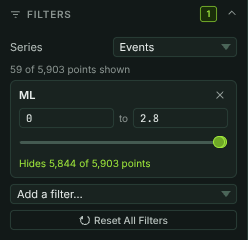
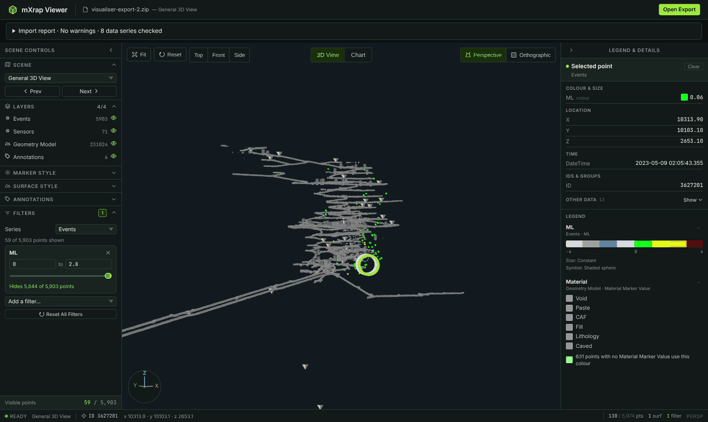
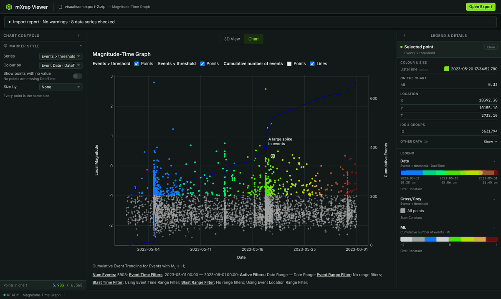

# Mining 3D Data Viewer: user guide

This guide is for geotechnical engineers and report recipients who want to explore an mXrap
export in a web browser. You do not need mXrap or a licence. Your data never leaves your
computer: the viewer reads the export file inside the browser and uploads nothing.

To install and start the viewer, see the [quick start](../README.md#quick-start).

## 1. Open an export

1. Click **Open Export** in the top-right corner.
2. Choose an mXrap export `.zip` (for a first try, use
   `mxrap-viewer/test-data/visualiser-export-2.zip`).
3. While the file loads, the button reads **Loading…** and the status bar shows **Loading**.
   When it shows **Ready**, the first scene is displayed and the file and scene names appear in
   the header.

Until you open a file, the viewer shows built-in demo data ("Demo data" in the header).

**Import report.** Below the header, the collapsible **Import report** lists every data series
with the number of records loaded and skipped, plus any warnings (for example rows with
missing coordinates or references to data that is not in the export). Rows that fail validation
are skipped, not drawn incorrectly. If the export cannot be read at all, the status bar turns red
and shows the error.

## 2. Move around the 3D view

| Action | Mouse | Trackpad |
| --- | --- | --- |
| Rotate | Left-drag | Drag |
| Pan | Right-drag, or Shift-drag | Shift-drag, or two-finger click and drag |
| Zoom | Scroll wheel | Pinch or two-finger scroll |

In a plan or section view (see below) the first two swap: dragging moves the view like a map,
and Shift-drag or right-drag rotates it.

The toolbar in the top-left corner of the view has:

- **Fit**: zoom to show everything that is visible now.
- **Reset**: go back to the camera position saved in the export.
- **Top**, **Front** and **Side**: plan and section views, like mXrap's XY, XZ and YZ buttons.
  **Top** looks straight down with north up, **Front** looks north and **Side** looks west.
  Each view is framed on the visible data.

The **Perspective / Orthographic** switch in the top-right corner changes the projection of the
current scene and keeps the current view. Orthographic has no perspective distortion, so it is clearest with
**Top**, **Front** or **Side**. In those views it also shows a coordinate grid, labelled along
the bottom and left edges, which keeps about 6 to 8 lines on screen as you zoom. The grid
disappears as soon as the view is tilted.

The axis indicator in the bottom-left corner shows the X, Y and Z directions at all times (in
mine exports X points east, Y north and Z up). Axes pointing away from you are drawn fainter.

## 3. Switch scenes

An export can contain several scenes. In the left sidebar, **Scene** shows the current scene;
choose another from the drop-down or use **Prev** / **Next**.

Each scene keeps its own settings. The first time you open a scene it looks the way the export
set it up: its camera, perspective or orthographic, and every layer as exported. If you change
the camera, the projection, layers, filters or marker style and then come back to the scene
later, it is as you left it. The marker size slider and the annotation text size, font and
colours apply to every scene.

## 4. Layers

The **Layers** section lists every data series in the scene (events, sensors, surfaces, RMQ
intervals, and so on). Click a layer to hide or show it. The status bar shows how many points
are visible out of the total, and how many surfaces are loaded.

## 5. Marker style

**Marker Style** controls how points are drawn for the selected **Series**:

- **Colour by**: colour points by an attribute (for example local magnitude); the matching
  legend appears in the right panel.
- **Show points with no value**: show or hide the points that have no value for the colour
  attribute. The line under it says how many points that is; when shown, they use the legend's
  missing-value colour.
- **Show legend**: show or hide this series' colour legend in the right panel. It starts as the
  export sets it; each scene remembers your choice.
- **Size by**: scale points by an attribute. **Min size** and **Max size** set the marker size at
  the low and high ends of the range; **Invert size** makes small values draw the largest
  markers. These three controls only appear when an attribute is selected; with **None**, every
  point is the same size.
- **Marker size** and **Symbol**: overall display size and marker shape.

These start from the settings saved in the export, so the view initially matches mXrap.

**Surface Style** (shown when the scene has surfaces) recolours a surface the same way. Choose the
**Surface** if there are several, then **Colour by** one of its attributes (for example Material
or Date; its legend appears in the right panel) or **Single colour** and pick the colour.
**Opacity** makes the surface see-through, so events behind it stay visible. Like the other
settings, each scene keeps its own surface styles.

![Surface Style colouring the painted surveys by P[ppv>design], with their legend on the right](images/surface-style.png)

## 6. Annotations

The **Annotations** section turns text labels on or off and changes their size, font, text
colour and background colour.

A callout that the export places at a location (for example "Area of interest" in the sample) is
drawn beside it with an arrow pointing to the spot, in the callout's colour. It stays on top of the
scene, so tunnels in front of the location do not hide it.

## 7. Filter data

1. Open **Filters**. If the scene has more than one point series, choose one under **Series**.
2. Pick a column from **Add a filter…**. A new filter starts with nothing hidden.
3. Each filter is a card. For numbers, type the lowest and highest values to show or drag the two
   slider handles; the slider moves by share of points, so moving a handle a tenth of the way hides
   about a tenth of the points. For dates, pick a date range; for categories, tick the values to
   keep.
4. The card says how many points the filter hides. If some points have no value in that column,
   a check box keeps or hides them.
5. Points outside the filters are hidden immediately. Remove a filter with its **×** button, or
   clear them all with **Reset All Filters**. The status bar shows how many filters are active.

## 8. Inspect a point

Hover over a point to preview its attributes; click to keep them in the **Selected point**
panel on the right. The details are grouped into **Colour & size** (the values that set its
colour and size, with the colour swatch), **Location**, **Time**, **IDs & groups** and **Other
data**; click **Show** to open **Other data**. The status bar also shows the point's ID (or its
row in the data file when there is no ID column) and its X, Y, Z coordinates. Click **Clear** to
deselect.

## 9. Legends

The right panel shows a legend for each coloured series: a colour ramp with tick labels for
numeric values or dates, or a list of colours for categories. Numbers and dates are written the
way the export asks, for example dates as `2023-05-01 12:31 am`. Each legend can be collapsed or expanded. The
**Collapse** button at the top of each side panel hides it to give the 3D view more space; click
the narrow strip that remains to expand it again.

## 10. Charts

If the export contains charts, **3D View** and **Chart** tabs appear at the top of the view.
Open **Chart** to see the Magnitude-Time chart (choose another chart from the drop-down if there
are several). An export with only charts opens straight on them. Each series has **Points** and
**Lines** check boxes to show or hide it. Axes, colours and logarithmic scales follow the chart
settings in the export.

The left sidebar follows the view on screen. With a chart open it shows **Chart Controls** in place
of the 3D scene's controls, and the 3D view's point details, point counts and projection are
hidden. Its **Marker Style** works as in the 3D view for the selected **Series**: **Colour by** an
attribute (or **Default colour**), **Show points with no value**, and **Size by** with **Min
size**, **Max size** and **Invert size**. The legend in the right panel follows the colour chosen.

Chart points can be inspected like 3D points (section 8): hover over one to see its details in the
right panel, and click it to keep them as the **Selected point**. The point is ringed on the chart,
and its details also list **On the chart**, the values it is plotted at (for example its date, or
its hours after the trigger and cumulative count). Click **Clear** or an empty part of the chart to
deselect.

The axes fit the series that are shown: hide the smaller events, for example, and the magnitude
axis closes in on the larger ones. An axis with a fixed minimum or maximum in the export keeps it.
When every series on an axis is hidden, the axis is hidden too, as in mXrap, together with any
chart note placed against it.

## Troubleshooting

| Problem | What to do |
| --- | --- |
| Nothing appears after loading | Click **Fit**; check that layers are not hidden and no filter excludes everything. |
| Warnings in the import report | The listed rows were skipped; the rest of the data is still shown. Check the export in mXrap if many rows are skipped. |
| Status bar shows **Error** | The file is not a valid mXrap export `.zip`, or a required file inside it is missing. |
| The browser becomes slow or crashes on a very large export | The whole export is held in memory; try a smaller export or a computer with more RAM. |
| The 3D view is blank on every file | Make sure WebGL is enabled in your browser and graphics drivers are up to date. |

To report a bug, open an issue at
<https://github.com/sharmashantanu319/Mining-3d-data-viewer/issues>.
